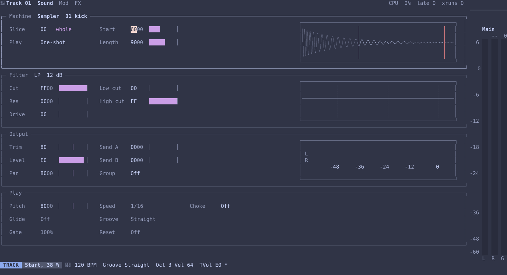
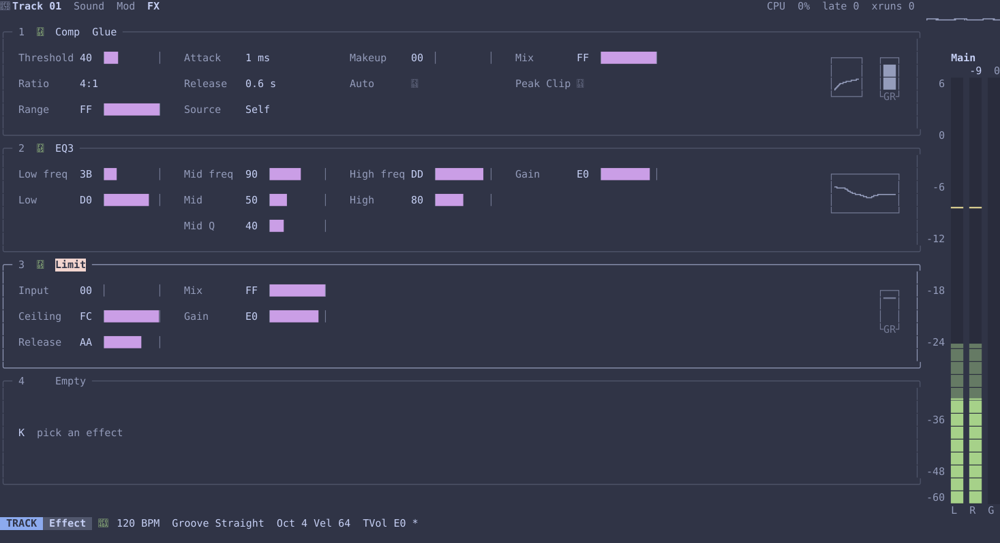

# vimtracker

[](https://gabrielgellner.github.io/vimtracker/)

A music tracker for the terminal, written in Rust and edited with a keyboard grammar modelled on
Neovim. It's a groovebox at about an Octatrack's scale, for making whole songs from the keyboard
and taking them into Ableton Live, which stays the DAW: it doesn't try to replace it. It takes
ideas from the Polyend Tracker, the Dirtywave M8, Elektron sequencers, the Metropolix and Jeskola
Buzz, but it's a separate program, and isn't affiliated with any of them.



The manual is at <https://gabrielgellner.github.io/vimtracker/>. The same guides are in the
program, on `Space ?`.

## What it has

*   **Editing as in Vim.** Operators with motions and targets, counts, registers, `.`, undo and
    redo, Visual modes and the jump list, over a grid of phrases, chains and a song.
*   **Time and feel.** Notes of any length in pulses, with a gate; lanes, FX columns looping on
    their own; grooves with humanise, a nudge for each row, a speed for each track, and per-track
    resets; trig conditions, accumulators, arpeggios and play orders, after Elektron, the
    Metropolix, Renoise and the M8.
*   **Sounds.** A sampler with a bank of samples, slices, marks and a sample page for editing them;
    and synth voices ported from Mutable Instruments' Plaits, with an acid voice of its own fitted
    to Arturia's Acid V and AudioRealism's ABL3. Kits, including one for each of Ableton Live's
    drum racks.
*   **A track** has a machine, a trim, a filter of nine types, four effect slots, three LFOs, three
    envelopes and two sends. Effects include delays, reverbs, compressors, an EQ, a limiter,
    distortion and guitar pedals, chorus, phaser, flanger, tape, pitch, granular, resonator, comb
    and vowel filters, and Mutable's Warps and Streams.
*   **Mixing.** Four groups, two returns and a master, each a track with its own slots, on a mixer
    page.
*   **Playing in.** Held keys sound while they're down, play chords, and record into a playing
    phrase as long as they were held.
*   **Out to Ableton.** `:render` writes the loop or the song as a WAV that loops cleanly, or stems
    for each track or group.

The track pages are racks of devices, as in Live:



## What it needs

*   **[kitty](https://sw.kovidgoyal.net/kitty/) or [Ghostty](https://ghostty.org).** vimtracker
    needs both of the kitty protocols: the keyboard protocol, which says when a key is held and
    let go, and the graphics protocol, as its curves, meters and waveforms are images. It won't
    start in other terminals or inside tmux, and isn't supported over ssh. `vimtracker probe-keys` says whether a
    terminal has both, and runs anywhere.
*   **The Nerd Font symbols,** for its icons and switches. kitty and Ghostty ship them built in, so
    there's nothing to install.
*   **macOS on Apple silicon** is where it's made and tested. Linux builds are made for each release
    but not tested.

The Option keys, such as `Option-1`, need kitty's `macos_option_as_alt yes` or Ghostty's
`macos-option-as-alt = true`. `Cmd-h` `Cmd-j` `Cmd-k` `Cmd-l` nudge a value, and kitty keeps three
of them for itself until your `kitty.conf` frees them;
[docs/terminal-notes.md](docs/terminal-notes.md#cmd-keys) has the lines.

## Install

**A release.** Each [release](https://github.com/gabrielgellner/vimtracker/releases) has
`vimtracker` built for macOS on Apple silicon (`aarch64-apple-darwin`) and Linux on x86-64 and
arm64, with a `SHA256SUMS` file. With the [GitHub CLI](https://cli.github.com/):

```sh
gh release download --repo gabrielgellner/vimtracker \
    --pattern '*aarch64-apple-darwin.tar.gz' --pattern SHA256SUMS
shasum -a 256 -c --ignore-missing SHA256SUMS
tar xzf vimtracker-*-aarch64-apple-darwin.tar.gz
mv vimtracker-*-aarch64-apple-darwin/vimtracker ~/.local/bin/   # or anywhere on your PATH
vimtracker --version
```

A file downloaded with a browser instead is quarantined by macOS, which then won't open it;
`xattr -d com.apple.quarantine vimtracker` lets it run.

**From source,** with the stable [Rust](https://rustup.rs/) toolchain:

```sh
cargo install --path crates/vt-tui --locked     # or: just install
```

On Linux, the audio output needs the ALSA headers (`libasound2-dev` on Debian and Ubuntu).

## Quick start

Use a release build for playing: a debug build uses far more of the audio deadline, even when
idle.

```sh
vimtracker my-song        # opens my-song, or creates it on the first :w
just run my-song          # the same, built from this checkout
```

1.  `Space 5` lists WAV, AIFF and FLAC files under the project, your kits and sample folders and
    the folder you ran from, for the current track, with each kit opening like a folder to its
    sounds. `:sample path` takes a file, or a folder to browse.
2.  `Space 3` opens the phrase view. `i` starts Insert, and the keyboard plays as in Ableton:
    `a` to `l` are white keys, `w` to `o` black keys, `z` and `x` change octave, `c` and `v` set
    the velocity written, and the arrows move without writing. A note stays where it's written,
    and `;` turns on auto-jump, which moves on by the grid. `Esc` leaves Insert.
3.  `Tab` plays and pauses. `Shift-Tab` plays from the start, and `Space c` from the cursor.
4.  `l` moves to the next field. `K` lists the FX commands, or type a label, `Enter`, then two hex
    digits, such as `CUT` `Enter` `40`.
5.  `Space 2` opens the chain view, where `gd` opens a phrase, or adds one on the empty row.
6.  `Space 4` opens the track page: its Sound, Mod and FX pages, on `H` and `L`.
7.  `:w` saves. `:render loop.wav` writes the loop, ready to drop into Ableton.

`Space Space` jumps between views. `Space ?` opens the guides, short tutorials on each topic,
and `Space k` lists every key. If you pause after `Space` or another prefix, a popup shows what
can come next.

No samples come with the repository. Put your own WAV, AIFF or FLAC files in
`~/Music/vimtracker/samples` to see them in the explorer. A file in `~/Music/vimtracker/kits`
listing sounds, such as `909.ron`, is a kit: `:kit 909 all` puts its sounds on tracks from the
first. Both folders are lists you can change in `~/.config/vimtracker/settings.ron`. With
Ableton Live installed, `vimtracker kits import-ableton` makes a kit of each of its drum racks,
pointing at Live's samples where they are. See the sounds guide.

Samples stay where they are, and a project refers to them. `:w new-folder` saves a copy with every
sample gathered into it, ready to move or share. Unsaved work is written to `song.autosave.ron`
every minute once the project has a folder, and is offered back the next time you open it after a
crash.

| Command | What it does |
|---|---|
| `:bpm 137.63` | Tempo |
| `:groove swing-66`, `:tgroove mpc-58`, `:tgroove off` | Project groove, this track's groove, follow the project |
| `:swing 66` | The project's swing groove at a percent |
| `:tvol C0` | This track's level, separate from each note's velocity |
| `:name BD`, `:name`, `:chain 2` | Name this track or clear its name, and which chain it plays |
| `:len 32`, `:double` | Phrase length, and repeat the phrase to double it |
| `:track add 4`, `:track del` | Add tracks, or remove the last |
| `:set skip=8`, `:seed 7` | The grid, which the left and right arrows and auto-jump move by, and the random seed for `CHA` |
| `:render path [--rows n] [--tail] [--stems] [--split]` | Render to a WAV file, or stems to a folder |

## Without a terminal

These run in any terminal, with no sound device unless asked:

| Command | What it does |
|---|---|
| `vimtracker render <project> <out.wav> [--rate n] [--rows n] [--seed n] [--tail] [--stems] [--split]` | Render a saved project, as `:render` does |
| `vimtracker bench <project> [--rate n] [--block n] [--seconds n]` | How much of a core a project takes, stopped and playing. `--tracks` adds each track's, slot's, group's, return's and the master's share, and `--device` plays silently through the output device to time its callback as the status line does |
| `vimtracker probe <spec.toml> <out.wav> [--case name]` | Play one voice or effect with no song, from a spec that [tools/compare](tools/compare/README.md) also renders through reference plugins and Ableton Live's devices, to compare the two |
| `vimtracker notes <project> <out.toml> [--track name] [--machine key]` | Write one track's notes from a song as a probe spec's, for tools/compare. The project is only read |
| `vimtracker probe-keys` | Show what your terminal sends, with the kitty keyboard protocol on as the program has it |
| `vimtracker kits import-ableton` | Write a kit for each of Ableton Live's drum racks |
| `vimtracker roto-probe` | List the MIDI and serial ports, and connect to a Roto-Control if one is plugged in: its firmware and API versions, its mode and the setups it stores, all only read |

`cargo build --profile profiling` builds with symbols for a profiler.

## Working on it

With [just](https://github.com/casey/just) installed, `just` lists the recipes:

| Recipe | What it does |
|---|---|
| `just run [project]` | Build and run the release build |
| `just test` | Every test |
| `just install` | Install the working tree's `vimtracker` into `~/.cargo/bin` |
| `just screenshots` | Remake the manual's screenshots, as SVGs in `docs/manual/src/images` |
| `just symbols-font` | After adding a Nerd Font symbol to `glyphs.rs`, cut the manual's font down to the symbols again, and write their outlines for the screenshots |
| `just docs`, `just docs-serve` | Build the manual, or serve it in a browser as it changes, with [mdBook](https://rust-lang.github.io/mdBook/) |
| `just live start`, `keys`, `text`, `screen`, `shot`, `stop` | Drive the release build in a kitty window of its own, to check a change by hand ([CONTRIBUTING.md](CONTRIBUTING.md#checking-the-real-program)) |
| `just live-bridge-install`, `just live-bridge-uninstall` | Link the comparison harness's bridge into Ableton Live's User Library, or take it away |
| `just changelog-preview`, `just bump`, `just release` | Make a release: see [CONTRIBUTING.md](CONTRIBUTING.md#releases) |

How to work on vimtracker, and how releases are made, is in [CONTRIBUTING.md](CONTRIBUTING.md).
The design, with an [Architecture](docs/designs/vimtracker.md#architecture) section that
describes the code as it is now, is in [docs/designs/vimtracker.md](docs/designs/vimtracker.md),
and the author's numbered decisions are in [docs/designs/decisions.md](docs/designs/decisions.md).
The manual's source is in [docs/manual](docs/manual/src/SUMMARY.md), and includes the guides in
`crates/vt-tui/guides`.

## License

GPL-3.0-or-later. See [LICENSE](LICENSE).
