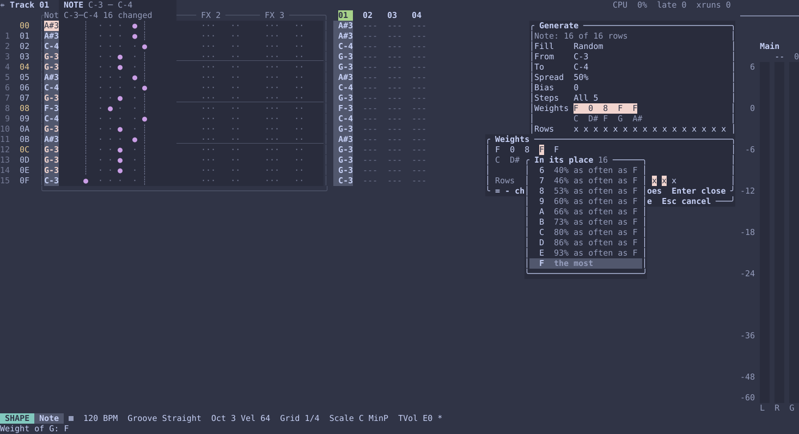

{{#include ../../../../crates/vt-tui/guides/editing.md:before-bars}}

{{#include ../../../../crates/vt-tui/guides/editing.md:after-bars}}

{{#include ../../../../crates/vt-tui/guides/editing.md:after-weights}}

![An Own rhythm's Text in its buffer under the shape panel's row: typed again with S, x(3,8) [. x]*2 x? . [x x x] . x(5,8,2) and more, longer than the row, which is cut, drawn whole as typed, brackets and commas as they are, the cursor on its first token, and under it the Rows line marking each row a hit writes, x, or one with a chance, ?](../images/shape-buffer.svg)

{{#include ../../../../crates/vt-tui/guides/editing.md:after-offer}}
