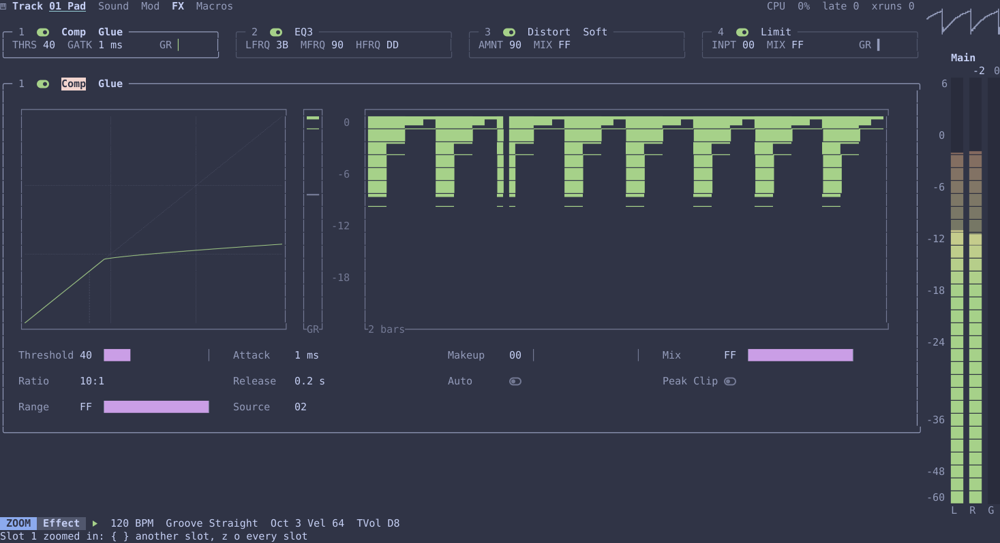
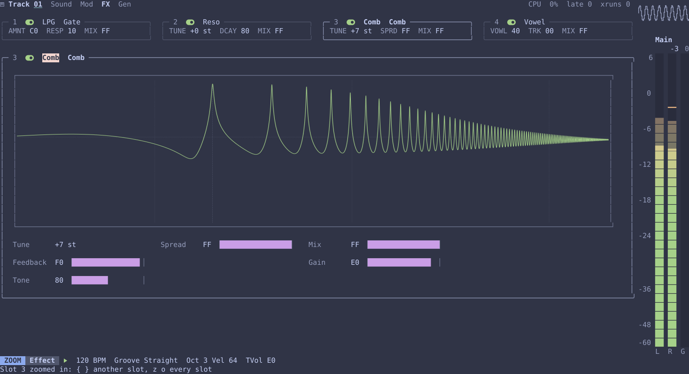
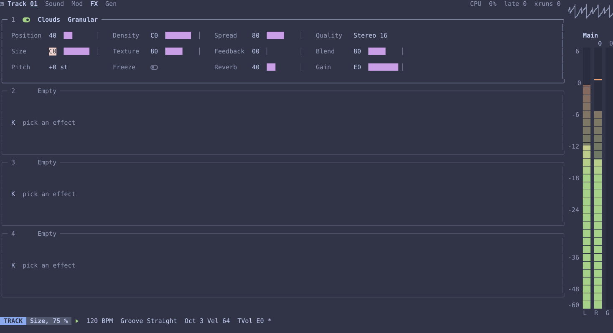

{{#include ../../../../crates/vt-tui/guides/track-fx.md:before-zoom}}

{{#include ../../../../crates/vt-tui/guides/track-fx.md:before-clouds}}

{{#include ../../../../crates/vt-tui/guides/track-fx.md:rest}}
