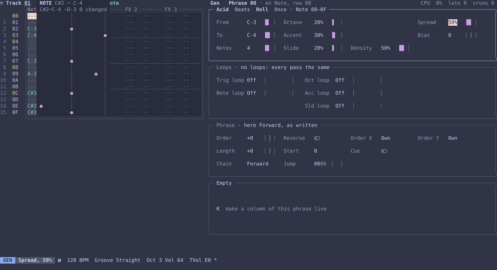
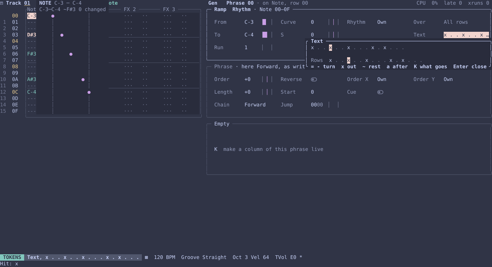
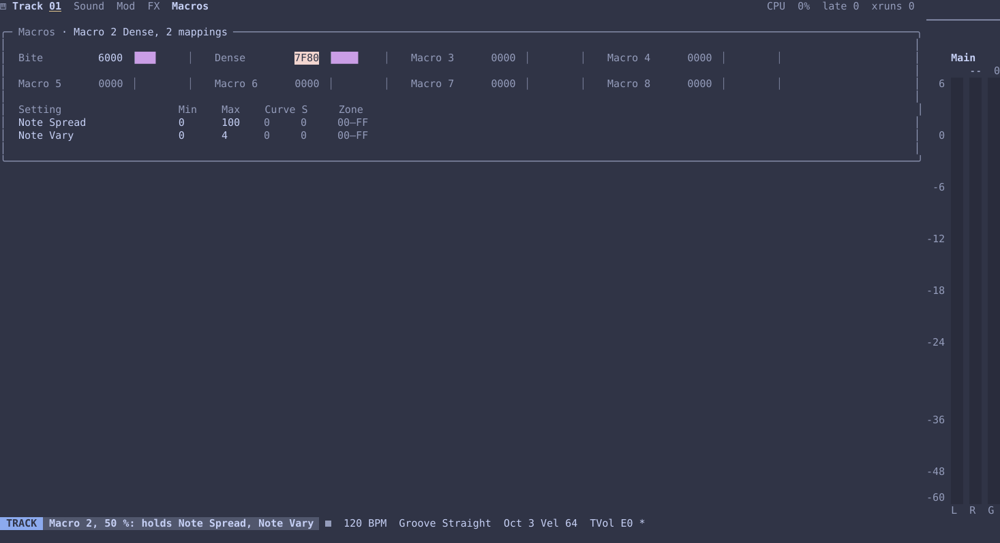
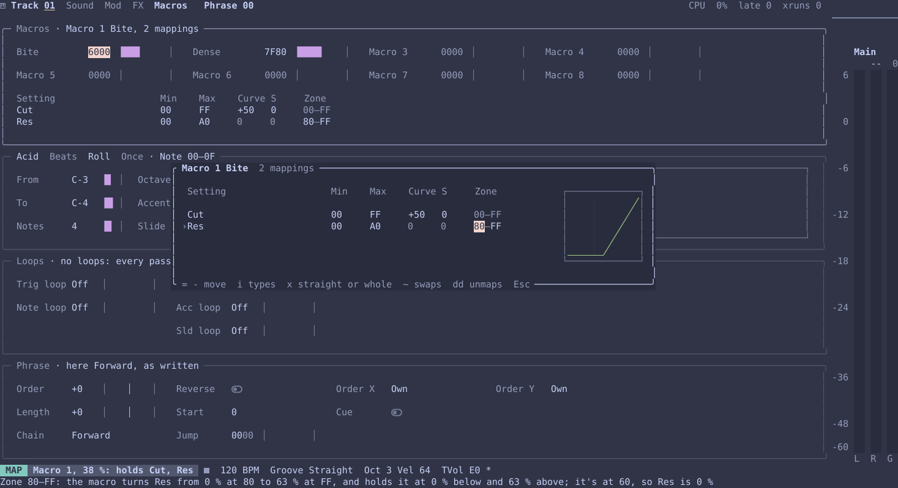
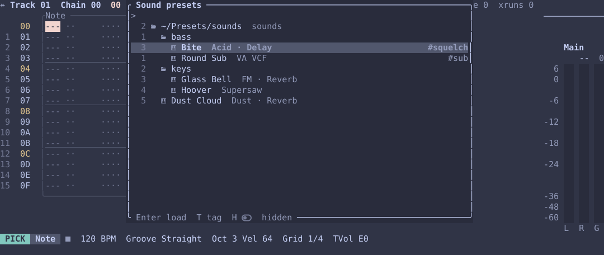

{{#include ../../../../crates/vt-tui/guides/track-gen.md:before-gen}}

{{#include ../../../../crates/vt-tui/guides/track-gen.md:before-macros}}

{{#include ../../../../crates/vt-tui/guides/track-gen.md:before-panel}}

{{#include ../../../../crates/vt-tui/guides/track-gen.md:before-mapping}}

{{#include ../../../../crates/vt-tui/guides/track-gen.md:before-presets}}

{{#include ../../../../crates/vt-tui/guides/track-gen.md:rest}}
