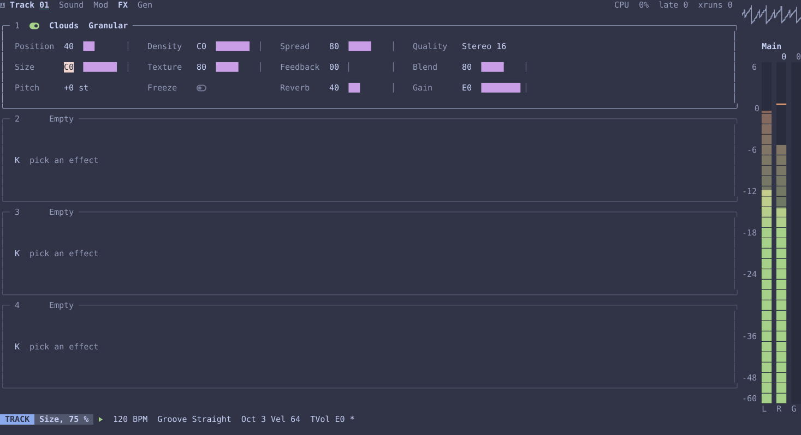
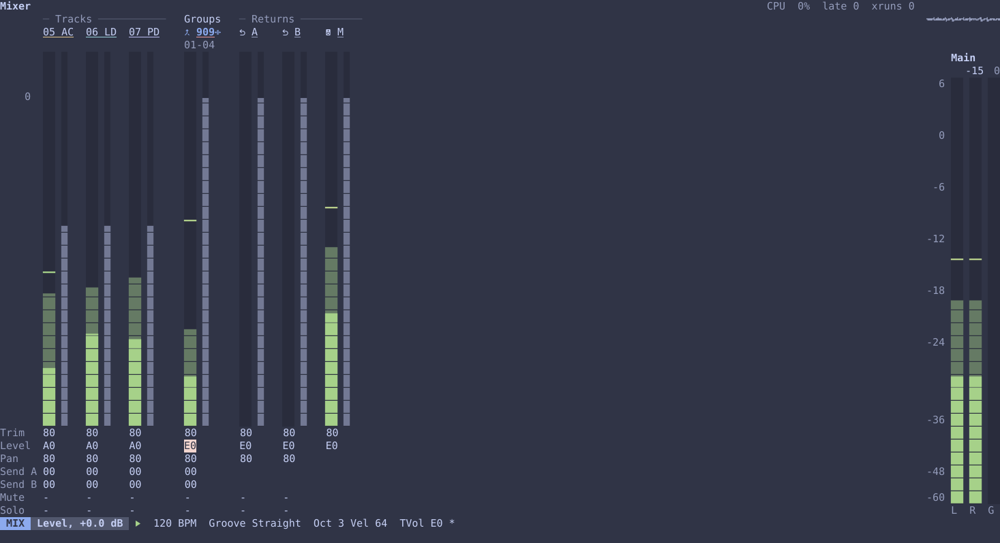
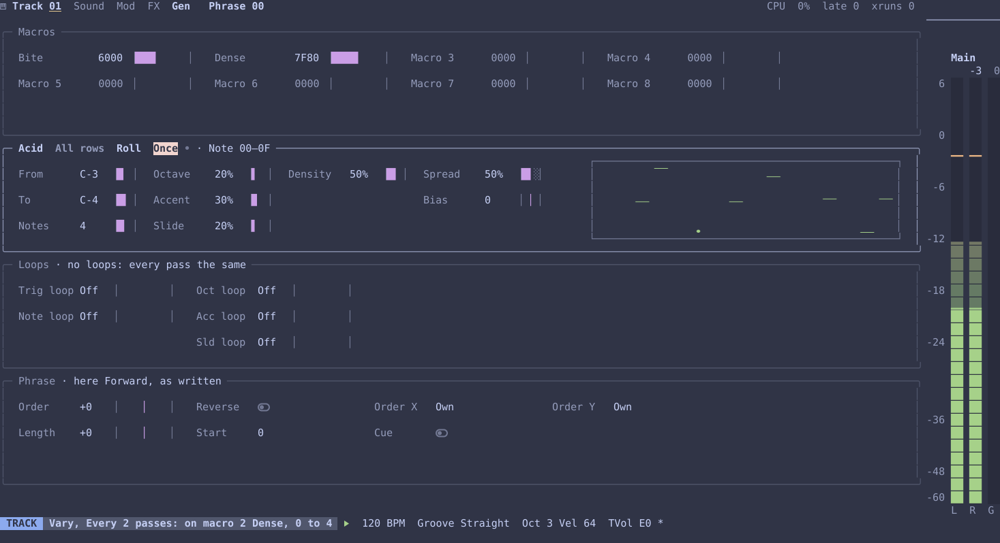
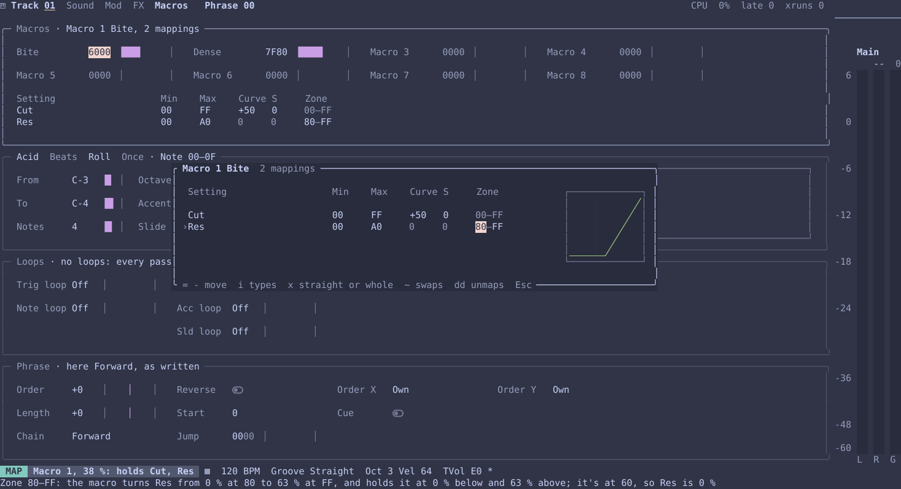
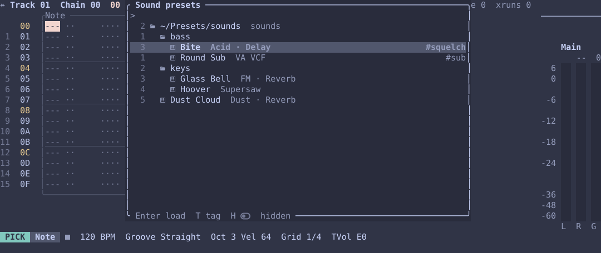

{{#include ../../../../crates/vt-tui/guides/tracks.md:before-clouds}}

{{#include ../../../../crates/vt-tui/guides/tracks.md:before-folded}}

{{#include ../../../../crates/vt-tui/guides/tracks.md:before-gen}}

{{#include ../../../../crates/vt-tui/guides/tracks.md:before-mapping}}

{{#include ../../../../crates/vt-tui/guides/tracks.md:before-presets}}

{{#include ../../../../crates/vt-tui/guides/tracks.md:rest}}
