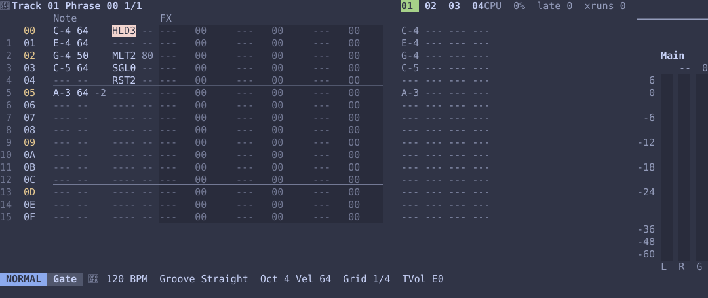
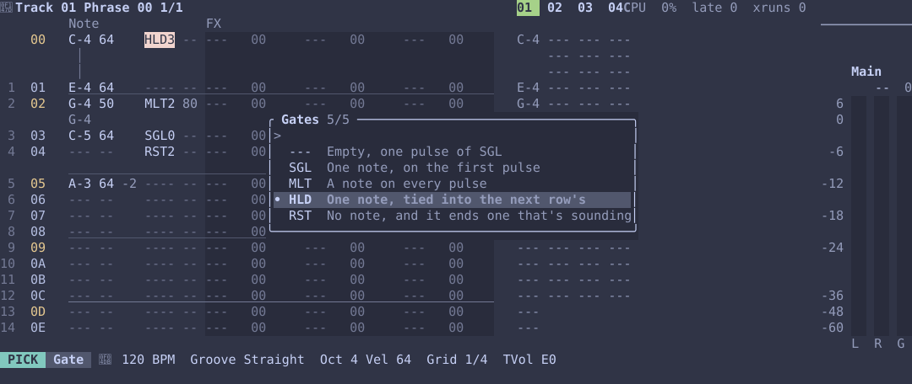
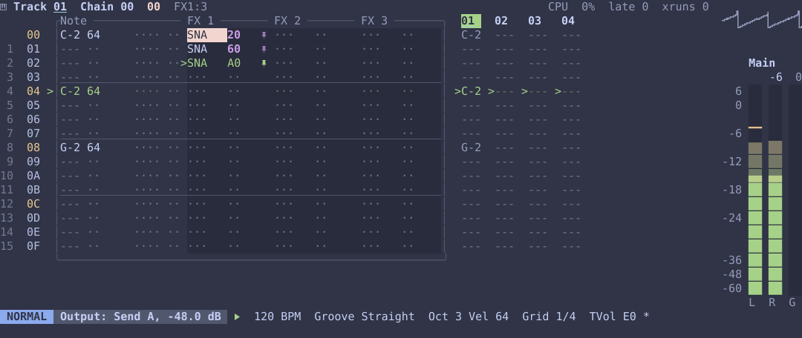

# How a track plays: time, gates and lanes

This chapter explains how a track turns its rows into sound over time. Most of the
time you won't need it, as a track plays its rows in order, one step each, as in any
tracker. It matters once rows have gates of different lengths, or FX columns loop on
their own.

## What a track plays

```text
Song
 └─ Section, a row of the song view: one chain for each track
     └─ Chain: a list of phrases, played in order, then round again
         └─ Phrase: stored rows, and a loop, the part that plays
```

A phrase stores more rows than it plays. Its **loop** is the window that plays, and
rows outside it are dim and silent.

```text
stored rows:  00 01 02 03 04 05 06 07 08 09 …
loop:                  [03 ............. 08]     only these play
```

## One row has four parts

```text
 Note  Vel     Gate      FX1         FX2         FX3
 C-4   40 -3   HLD3 --   CUT   40 .  ---   00    ---   00
 └─ what sounds          └─ what changes while it plays
              └─ how long it lasts
```

- **Note and velocity** are what sounds. The dim pair after the velocity is the row's
  **nudge**, how far early or late its note plays, in 24ths of a step, and it's blank
  on a row on the grid.
- **Gate** is how long the row lasts, in **pulses**, which are steps, from `0` to `8`,
  and what the note does over that time. An empty cell, `----`, is one pulse of `SGL`,
  as every row was before gates. The dim pair after it is how long the note lasts, and
  `--` leaves that to the track.
- **FX columns** hold commands such as `CUT`, `RET` and `CHA`.

## Time: one count, which everything reads

The engine has one clock, the **step**, a sixteenth note at normal speed. Each track
keeps a **count**: how many steps since its chain started. Everything on the track
works out where it is from that one number. A track's step is a sixteenth unless its
`Speed` makes it longer or shorter: see **Speed: a track's own step** below.

```text
count:   0   1   2   3   4   5   6   7   8 …      one for each step
```

## The note column reads rows by their length

With gates, a row can take several steps, or none:

```text
rows:     00 HLD3      01 SGL1   02 SGL0   03 MLT2
steps:    0   1   2    3         none      4   5
count:    ├─ row 00 ─┤ ├row 01┤            ├row 03┤
```

So count 4 is row 03, and row 02 is skipped. The note column's loop is the phrase's
loop, and when it ends, the chain moves on to its next phrase.

| Gate | Over its pulses |
|---|---|
| `SGL` | One note, on the first |
| `MLT` | A note on each |
| `HLD` | One note, tied into the next row's note with no new attack |
| `RST` | No note, and it ends one that's sounding |

Any gate with `0` pulses skips its row.

How long each note sounds within its row is a share of the note's last pulse: the
row's own length, the dim pair in its gate cell, or the track's `Gate` where it has
none. At `100%`, the default, a note holds until something ends it. Below that, its
gate closes that far through its last pulse and its release starts, as with `OFF`:

```text
Gate 50%:
rows:     00 SGL3                 01 MLT2         02 HLD1 03 SGL1
steps:    0       1       2       3       4       5       6
gate:     ━━━━━━━━━━━━━━━━━━━━────━━━━────━━━━────━━━━━━━━━━━━────
```

A `SGL` holds through its row and closes halfway through its last pulse, each of a
`MLT`'s notes lasts half its pulse, and a `HLD` ties on into the next row's note,
which closes its own gate. `Acid` starts at `50%`, as a 303 does. An LFO on `Gate`,
and `LDLT` on a step, move each note's length up or down from that, a row's own too.

Here's a phrase with gates. Row 00 holds for 3 steps, then ties into row 01. Row 02
plays twice, each note half its pulse long, row 03 is skipped, and row 04 rests for 2
steps. The yellow numbers are
beats, and they fall on the rows that start on a beat, however long the rows before
them are.



`K` on the gate column chooses a gate from a list, keeping its pulses:



## An FX column has two modes

### Without a lane: it follows the notes

This is the default. The column is tied to the note column: it reads the same row,
and that row's FX run on the row's first pulse.

```text
count:      0    1    2    3
note row:   00   00   00   01         row 00 is HLD3
FX1 row:    00   00   00   01         its FX run at counts 0 and 3
```

The exception is `MLT`, which plays a note on every pulse. Its row's `DEL`, `KIL`,
`OFF` and `RET` run on every pulse too, though its `CHA` is rolled once, for the row.

Because the column is tied to the notes, changing the phrase's loop changes it too.

### With a lane: it runs on its own

`:lane 3` gives the cursor's FX column a **lane**: a loop of its own, 3 steps long.
It reads by step, whatever the note rows are doing:

```text
FX1's lane is rows 00 to 02

count:      0  1  2  3  4  5  6  7  8  9 …
lane row:   00 01 02 00 01 02 00 01 02 00         count % 3
note row:   00 01 02 03 04 05 06 07 08 09         a 16-row loop
```

Here FX 1 is a lane of 3, with the title showing `FX1:3`. After 21 steps the notes
are on row 04, while the lane, with its own `>`, is on row 02, as `20 % 3 = 2`. The
rows outside its lane are dim in that column only.



On the phrase's second pass, at count 16, the notes are back at row 00, but the lane
is at row `16 % 3 = 1`. That's the **drift**, and it carries on across repeats and
into the next phrase of the chain. Against long rows, a lane keeps moving inside them:

```text
count:      0    1    2    3
note row:   00 ── HLD3 ──   01
lane row:   00   01   02   00         a new value every step, even mid-note
```

`RET` and `CHA` in a lane are ratchet and probability lanes, as on Metropolix: they
act on whatever step they land on, and do nothing on a step with no note. `LDLT` in a
lane is a length lane: it moves each note's length up or down from its own, so the
same row plays short one pass and long the next.

### The two side by side

| | No lane | With a lane |
|---|---|---|
| Its loop | The phrase's loop | Its own start and length |
| The row it reads | The note's row | Its count, wrapped to its lane |
| When its FX run | Each row's first pulse | Every step |
| Long and skipped note rows | Follows them | Ignores them, and drifts |
| Changing the phrase's loop | Changes it too | Leaves it alone |
| Made with | Nothing: it's the default | `:lane 3` |
| Back to following the notes | | `:lane` |

## What starts the count over

The count, and with it every lane, starts over on:

- playing from the top, or from a step;
- a section bringing in a new chain, or a section that resets;
- a launch;
- realigning with `:reset`.

Each of those also lines the track's steps up again, so a track at a slower speed
starts its next step there, even if that cuts the one before short.

Edits while playing don't start it over. Changing `:len`, a gate's pulses, a chain, a
lane's length, or undoing one of them, leaves the track on the row it was about to
play, and on the pulse within that row, and a lane on its step. If that row has gone,
the track starts its chain again on its next step.

So playing from a step hears exactly what playing up to it would, since both work the
count out in the same way.

## The groove moves steps, not the count

A groove (see **Groove** in the FX guide) moves where each step lands, a little late
or early, but never the count: each step is still the step it was, it only sounds a
few ticks from its place on the grid. The groove counts each track's own steps from
the song's start or its last reset, so every track swings on the same steps whatever
its length, and a track at `1/8` swings its eighths:

```text
steps:     0    1    2    3          Swing 66: every other step 77 ticks late
grid:      |    |    |    |
heard:     |     |   |     |
```

Everything on a step moves with it: each pulse of a `MLT`, a lane's value, `DEL`
counting from where the step lands, and a note's `Gate`, which is a share of its
step as the groove makes it. A step's `GRV` chooses its groove before it lands.

## A nudge moves a row's note, not its lanes

A row's nudge moves its note part off where the groove lands its step, up to `B`
24ths, just under half a step, either way. The order is grid, then groove, then
nudge:

```text
steps:     0    1    2    3          Swing 66, with step 3's row nudged -B
grid:      |    |    |    |
groove:    |     |   |     |
heard:     |     |   |   |            a little early, as -B is more than 77 ticks
```

What moves with it is what belongs to the note: the note with its velocity and
length, so its end moves with its start; the row's own FX columns, the ones without
a lane; `DEL`, `KIL`, `OFF`, `RET` and `CHA` from any column, which count from where
the note now starts; the envelopes; and every pulse of a `MLT`. What stays is what
keeps time on its own: a column with a lane, the LFOs and the groove. So a note
nudged early on a step where a lane changes a value starts with the value before,
and the lane's change comes in on the grid.

A track's notes always play in order. A nudge can't take a row's note past the
next row's on the grid, but a groove's pushes on top of nudges can: then the later
row waits for the earlier one, and is the note left sounding.

## Speed: a track's own step

A track's `Speed` is how long its step is, as a note division: `1/32`, `1/16T`,
`1/16`, `1/8T`, `1/8`, `1/4T` or `1/4`. Everything on the track counts its own
steps, so at `1/8` it moves down its rows half as fast, and its playhead is drawn
where it is:

```text
sixteenths:  0   1   2   3   4   5   6   7   8
1/16 track:  00  01  02  03  04  05  06  07  08
1/8 track:   00      01      02      03      04
1/16T track: 00 01  02 03  04 05  06 …           three to every two sixteenths
```

What's a share of a step is a share of the track's: each pulse of a gate, a lane's
step, `DEL`'s sixths, a nudge's 24ths, a groove's pushes and a note's `Gate`. The
LFOs keep to the song's time.

The song itself counts sixteenths. A section lasts its longest chain at that chain's
speed, so 16 rows at `1/8` take 32 sixteenths, and a triplet chain that doesn't end on
a sixteenth rounds up to the next. Resets, launches, `:reset` and renders count
sixteenths too. Inside a section a triplet track runs on, on its own grid, and lines
up again where its chain next starts.

`RATE` on a step changes the speed for that step and the rest of its note, or from
there on if it's held with `h`. A step at a new speed lasts until the next of that
speed's steps, counted from where the track last lined up, so the track keeps to the
grid of whatever speed it's at:

```text
sixteenths:  0   1   2   3   4   5   6
rows:        00  01  02      03      04       RATE 04h, 1/8, on row 01
                 └ lasts to the next eighth
```

## The keys, by column

| Cursor on | `gs`, `ge`, `:len` | `:lane 3` |
|---|---|---|
| Note, velocity or gate | The phrase's loop | Says it works on an FX column |
| An FX column without a lane | The phrase's loop | Makes it a lane |
| An FX column with a lane | That lane | Makes a new lane of 3, from the cursor's step |

`gg` and `G` follow the same rule: on a lane they go by the lane, and everywhere else by
the phrase's loop.

In short: notes walk rows that each take some steps, FX columns follow those rows unless
you give them a lane, and a lane counts plain steps on a loop of its own, which is where
the drift comes from.
