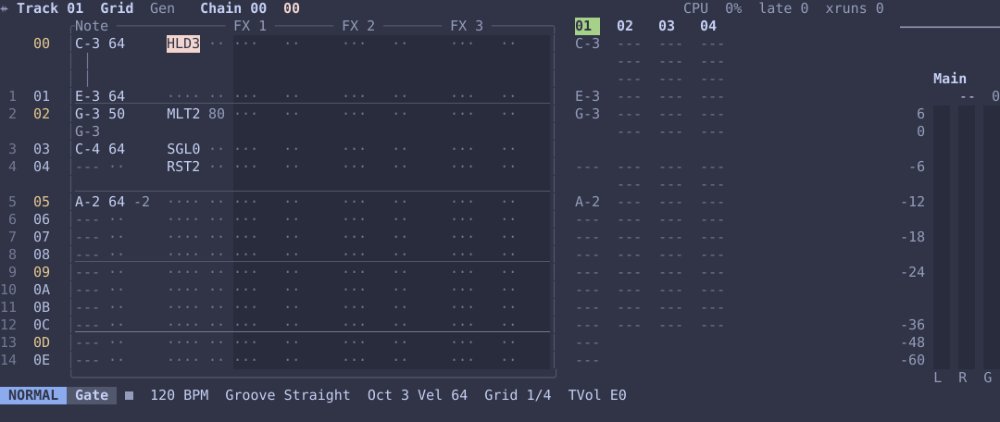
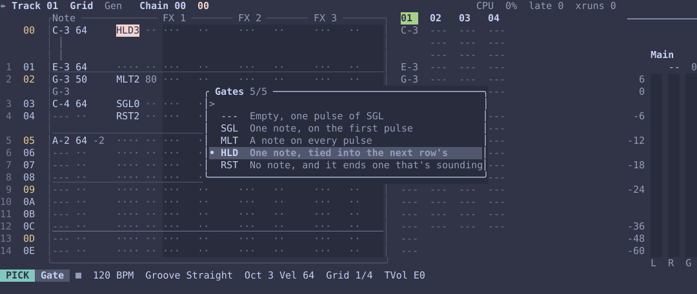
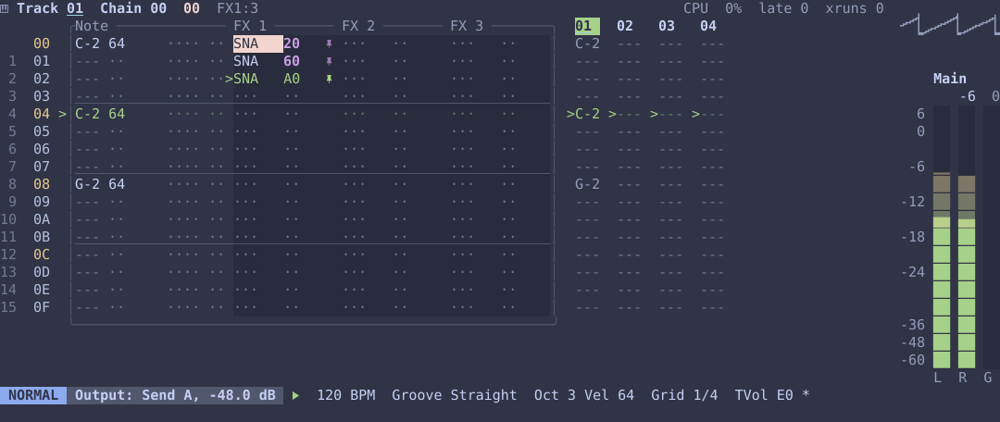
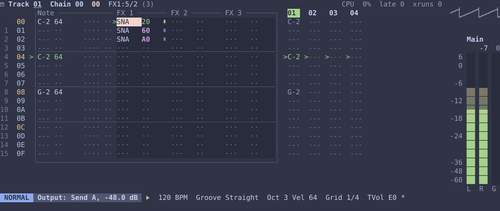
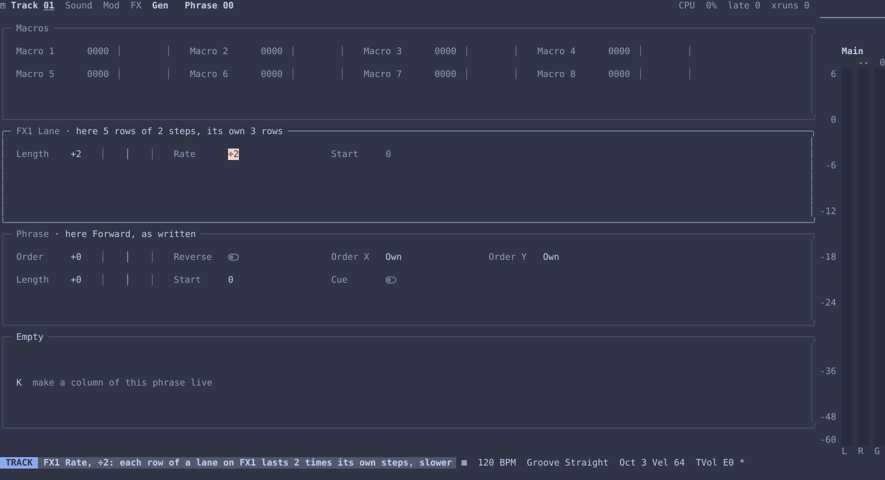

# How a track plays: time, gates, lanes and routing

This chapter explains how a track turns its rows into sound over time, and where
that sound goes. Most of the time you won't need it, as a track plays its rows in
order, one step each, as in any tracker. It matters once rows have gates of different
lengths, FX columns loop on their own, or a phrase plays its rows in another order.

The track settings named here are on its track pages, `Space 5` to `Space 8`: `Gate`, `Glide`,
`Speed`, `Groove` and `Reset` in the Play device on the Sound page, the accumulator and
the arpeggio on the Mod page, and the effects on the FX page.

## What a track plays

```text
Song
 └─ Section, a row of the song view: one chain for each track
     └─ Chain: a list of phrases, played in order, then round again
         └─ Phrase: stored rows, and a loop, the part that plays
```

A phrase stores more rows than it plays. Its **loop** is the window that plays, and
rows outside it are dim and silent.

```text
stored rows:  00 01 02 03 04 05 06 07 08 09 …
loop:                  [03 ............. 08]     only these play
```

## One row has four parts

```text
 Note  Vel     Gate      FX1         FX2         FX3
 C-3   40 -3   HLD3 ··   CUT   40 .  ···   ··    ···   ··
 └─ what sounds          └─ what changes while it plays
              └─ how long it lasts
```

- **Note and velocity** are what sounds. The dim pair after the velocity is the row's
  **nudge**, how far early or late its note plays, in 24ths of a sixteenth, and it's blank
  on a row on the grid.
- **Gate** is how long the row lasts, in **pulses**, which are steps, from `0` to `8`,
  and what the note does over that time. An empty cell, `····`, is one pulse of `SGL`,
  as every row was before gates. The dim pair after it is how long the note lasts, and
  `··` leaves that to the track. Empty cells are faint dots, and the note's is `---`.
- **FX columns** hold commands such as `CUT`, `RET` and `CHA`. A step has three. They
  aren't the FX page's four effect slots, though a step's commands can reach those,
  as `1BYP` does.

## Time: one count, which everything reads

The engine has one clock, the **step**, a sixteenth note at normal speed. Each track
keeps a **count**: how many steps since its chain started. Everything on the track
works out where it is from that one number. A track's step is a sixteenth unless its
`Speed` makes it longer or shorter: see **Speed: a track's own step** below.

```text
count:   0   1   2   3   4   5   6   7   8 …      one for each step
```

## The note column reads rows by their length

With gates, a row can take several steps, or none:

```text
rows:     00 HLD3      01 SGL1   02 SGL0   03 MLT2
steps:    0   1   2    3         none      4   5
count:    ├─ row 00 ─┤ ├row 01┤            ├row 03┤
```

So count 4 is row 03, and row 02 is skipped. The note column's loop is the phrase's
loop, and when it ends, the chain moves on to its next phrase.

| Gate | Over its pulses |
|---|---|
| `SGL` | One note, on the first |
| `MLT` | A note on each |
| `HLD` | One note, tied into the next row's note with no new attack |
| `RST` | No note, and it ends one that's sounding |

Any gate with `0` pulses skips its row.

How long each note sounds within its row is a share of the note's last pulse: the
row's own length, the dim pair in its gate cell, or the track's `Gate` where it has
none. At `100%`, the default, a note holds until something ends it. Below that, its
gate closes that far through its last pulse and its release starts, as with `OFF`:

```text
Gate 50%:
rows:     00 SGL3                 01 MLT2         02 HLD1 03 SGL1
steps:    0       1       2       3       4       5       6
gate:     ━━━━━━━━━━━━━━━━━━━━────━━━━────━━━━────━━━━━━━━━━━━────
```

A `SGL` holds through its row and closes halfway through its last pulse, each of a
`MLT`'s notes lasts half its pulse, and a `HLD` ties on into the next row's note,
which closes its own gate. `Acid` starts at `50%`, as a 303 does. An LFO on `Gate`,
and `LDLT` on a step, move each note's length up or down from that, a row's own too.

Here's a phrase with gates. Row 00 holds for 3 steps, then ties into row 01. Row 02
plays twice, each note half its pulse long, row 03 is skipped, and row 04 rests for 2
steps. The yellow numbers are
beats, and they fall on the rows that start on a beat, however long the rows before
them are. A faint line under a row says a beat starts on the next, and a brighter one
a bar.

The phrase view is laid out in time: a row takes a line for each of its pulses, so
row 00 takes three. Its first line is the row, and the rest are dim, with `│` under a
note it holds and a `MLT`'s note again on each of its pulses. `j` and `k` still go a
row at a time, and counts, selections and the numbers beside the rows count rows.
The other tracks' columns beside the grid line up by time too, so each line shows
what they start in it. `z i` collapses the view to a line a row, and opens it again.



`K` on the gate column chooses a gate from a list, keeping its pulses:



`K` on the dim length after it chooses a length from a list instead, from a click
at `08`, through a 303's half at `80`, to the whole pulse at `FF`, or `--` for the
track's `Gate`.

## A tie glides as long as `Glide` says

A `HLD` ties its note into the next row's, which carries the same note on at a new
pitch with no new attack. The track's `Glide`, in the Play device on its Sound page,
is how long the pitch takes to get there, in ms. `Off`, the default, jumps, as a tie
always has, but `Acid` slides by its own `Slide`, as a 303 does. Set, it glides on every voice: a
synth by its pitch and a sample by its speed, so a sample's pitch and its speed move
together, as a tape's do.

```text
rows:     00 C-3 HLD1          01 C-4
pitch:    C-3 ─────────────────╱‾‾‾‾‾‾‾‾‾‾‾ C-4
                               ├┤ Glide 60 ms
```

It's a lag, as a 303's slide is: quick at first and slowing as it nears the note,
halfway in pitch at about a quarter of its time, nearly there when its time is up,
whatever the interval. It's in ms rather than a share of the step, so a glide
sounds the same at any tempo and `Speed`, as a slide does on a synth; a glide that
has to land on a row is `PTCH`'s glide mark, which goes by rows. `GLD` on a step
sets it for that tie, on the row tied from or the row tied into, as the tie is
still the same note. An `ARP`'s notes with `Retrig` off are ties too, so they glide
as well. A note that isn't tied glides only with the track's `Glide mode` at
`Always`: see [How a note plays](#how-a-note-plays-gate-mode-slides-glide-and-retrigger).

## An FX column has two modes

### Without a lane: it follows the notes

This is the default. The column is tied to the note column: it reads the same row,
and that row's FX run on the row's first pulse.

```text
count:      0    1    2    3
note row:   00   00   00   01         row 00 is HLD3
FX1 row:    00   00   00   01         its FX run at counts 0 and 3
```

The exception is `MLT`, which plays a note on every pulse. Its row's `DEL`, `KIL`,
`OFF` and `RET` run on every pulse too, though its `CHA` is rolled once, for the row.

Because the column is tied to the notes, changing the phrase's loop changes it too.

### With a lane: it runs on its own

`:lane 3` gives the cursor's FX column a **lane**: a loop of its own, 3 steps long.
It reads by step, whatever the note rows are doing:

```text
FX1's lane is rows 00 to 02

count:      0  1  2  3  4  5  6  7  8  9 …
lane row:   00 01 02 00 01 02 00 01 02 00         count % 3
note row:   00 01 02 03 04 05 06 07 08 09         a 16-row loop
```

Here FX 1 is a lane of 3, with the title showing `FX1:3`. After 21 steps the notes
are on row 04, while the lane, with its own `>`, is on row 02, as `20 % 3 = 2`. The
rows outside its lane are dim in that column only.



On the phrase's second pass, at count 16, the notes are back at row 00, but the lane
is at row `16 % 3 = 1`. That's the **drift**, and it carries on across repeats and
into the next phrase of the chain. Against long rows, a lane keeps moving inside them:

```text
count:      0    1    2    3
note row:   00 ── HLD3 ──   01
lane row:   00   01   02   00         a new value every step, even mid-note
```

`RET` and `CHA` in a lane are ratchet and probability lanes, as on Metropolix: they
act on whatever step they land on, and do nothing on a step with no note. `LDLT` in a
lane is a length lane: it moves each note's length up or down from its own, so the
same row plays short one pass and long the next. `VDLT` is its twin for velocity, so
a lane of it is an accent pattern that drifts against the notes, and the notes keep
the velocities they're written with.

### A slow lane, and one turned from the track

`:lane 4/2` gives the lane 4 rows that each last 2 of the track's steps, and `:lane /3` changes
only how long its rows last: it moves on a row every so many steps, as Kria's divisions do. A
slow row is read as a row of several pulses is: its FX run on its first step, so a `RET` or a
`CHA` acts once a row, and a lock or a hold of it holds through the rest. The title says
`FX1:4/2`.

Each FX column also has a `Length` and a `Rate` on the track, on the Gen page's `FX1 Lane`,
which move every phrase's lane on that column from its own, as a macro, a mod slot or a step's
`LLEN1` and `LRAT1` can. A lane heard longer than its own plays its own rows again from the
first; nothing is written, so at `+0` and `×1` it's as written:

```text
FX1's lane is rows a b c d, Length +2, Rate ÷2

count:      0  1  2  3  4  5  6  7  8  9  10 11 12
lane row:   a  a  b  b  c  c  d  d  a  a  b  b  a     6 rows heard, each 2 steps
```

The title shows what's heard first and its own after, dim, `FX1:5/2 (3)` for the lane of 3
below, and its playhead the row being read, a copy's own. A turn takes effect at the lane's next
row: it counts along from where it is, and playing from a step works its place out again there.





### The two side by side

| | No lane | With a lane |
|---|---|---|
| Its loop | The phrase's loop | Its own start and length |
| The row it reads | The note's row | Its count, wrapped to its lane |
| When its FX run | Each row's first pulse | Each of its rows' first step, every step at `/1` |
| Long and skipped note rows | Follows them | Ignores them, and drifts |
| Changing the phrase's loop | Changes it too | Leaves it alone |
| Made with | Nothing: it's the default | `:lane 3`, or `:lane 4/2` for slow rows |
| Back to following the notes | | `:lane` |

## What starts the count over

The count, and with it every lane, starts over on:

- playing from the top, or from a step;
- a section bringing in a new chain, or a section that resets;
- a launch;
- realigning with `:reset`, or by hand with `Space A`, which waits for the next line
  of the launch grid, a bar unless `:launch` changes it, and which a second press
  takes back;
- the track's own `Reset`, or `Space a`, which realigns just the cursor's track as
  `Space A` realigns them all.

Each of those also lines the track's steps up again, so a track at a slower speed
starts its next step there, even if that cuts the one before short.

### A track's own reset

`Reset`, in the Play device on the Sound page, under `Speed` and `Groove`, starts the
track's chain again every so many of the song's steps, while the other tracks drift
on. A 5-step part with `Reset` at `1bar` plays five, five, five and one, the same bar
every time, while a 7-step part beside it drifts:

```text
song:        0 1 2 3 4 5 6 7 8 9 A B C D E F | 0 1 2 3 4 5 6 7 8 9 A B C D E F
5, 1bar:     0 1 2 3 4 0 1 2 3 4 0 1 2 3 4 0 | 0 1 2 3 4 0 1 2 3 4 0 1 2 3 4 0
7, Off:      0 1 2 3 4 5 6 0 1 2 3 4 5 6 0 1 | 2 3 4 5 6 0 1 2 3 4 5 6 0 1 2 3
```

Type a number of steps, such as `5`, or of bars, such as `2bar`, or `off`; `=` and
`-` move it a step, `+` and `_` to the next whole bar, and `x` turns it off. It
counts the song's sixteenths whatever the track's `Speed`, and from where the
track's chain last started: a section bringing a new chain in, a launch, a realign
or its own last reset. So it's always that many steps of the chain. It isn't a
step's lock.

A reset is the start of the track's chain, as a section bringing it in is: the
chain plays from its top with its lanes in line, conditions count passes from the
first, accumulators set to `Chain` or to loops start again, and the phrase's walk
starts again. The groove carries on counting the track's steps, so the track
swings on the same sixteenths as every other, however odd its reset.

A section's `:reset` and the track's own both apply. The section's realigns every
track, so the track's own counts again from there: with `Reset` at 8 and `:reset 12`,
the track starts again at 8, 12, 20, 24 and so on. Where the two fall together, the
track starts once.

Edits while playing don't start it over. Changing `:len`, a gate's pulses, a chain, a
lane's length, a phrase's order, or undoing one of them, leaves the track on the row it
was about to play, and on the pulse within that row, and a lane on its step. If that row has gone,
the track starts its chain again on its next step.

So playing from a step hears exactly what playing up to it would, since both work the
count out in the same way.

## The groove moves steps, not the count

A groove (see **Groove** in the FX guide) moves where each step lands, a little late
or early, but never the count: each step is still the step it was, it only sounds a
few ticks from its place on the grid. The groove counts each track's own steps from
the song's start or its last reset, so every track swings on the same steps whatever
its length, and a track at `1/8` swings its eighths:

```text
steps:     0    1    2    3          Swing 66: every other step 77 ticks late
grid:      |    |    |    |
heard:     |     |   |     |
```

Everything on a step moves with it: each pulse of a `MLT`, a lane's value, `DEL`
counting from where the step lands, and a note's `Gate`, which is a share of its
step as the groove makes it. A step's `GRV` chooses its groove before it lands.

## A nudge moves a row's note, not its lanes

A row's nudge moves its note part off where the groove lands its step, in 24ths of
a sixteenth, 96 to a quarter note as on the MPC, up to just under half the track's
step either way: `B` at `1/16`, `5` at `1/32`, `2F` at `1/4` and `5F` at `1/2`. At
`1/1` it stops at `7F`, a third of the step, as far as a nudge goes. A 24th is the same
time on every track, so the same nudge pushes a slow part as much as a fast one. The
order is grid, then groove, then nudge:

```text
steps:     0    1    2    3          Swing 66, with step 3's row nudged -B
grid:      |    |    |    |
groove:    |     |   |     |
heard:     |     |   |   |            a little early, as -B is more than 77 ticks
```

What moves with it is what belongs to the note: the note with its velocity and
length, so its end moves with its start; the row's own FX columns, the ones without
a lane; `DEL`, `KIL`, `OFF`, `RET` and `CHA` from any column, which count from where
the note now starts; the envelopes; and every pulse of a `MLT`. What stays is what
keeps time on its own: a column with a lane, the LFOs and the groove. So a note
nudged early on a step where a lane changes a value starts with the value before,
and the lane's change comes in on the grid.

A track's notes always play in order. A nudge can't take a row's note past the
next row's on the grid, but a groove's pushes on top of nudges can: then the later
row waits for the earlier one, and is the note left sounding.

## Speed: a track's own step

A track's `Speed` is how long its step is, as a note division: `1/32`, `1/16T`,
`1/16`, `1/8T`, `1/16D`, `1/8`, `1/4T`, `1/8D`, `1/4`, `1/4D`, `1/2` or `1/1`, `D`
being dotted, half as long again. A canon's slow voice, the theme at a quarter of
its speed, is a track at `1/2` beside one at `1/8`. Everything on the track counts its own
steps, so at `1/8` it moves down its rows half as fast, and its playhead is drawn
where it is:

```text
sixteenths:  0   1   2   3   4   5   6   7   8
1/16 track:  00  01  02  03  04  05  06  07  08
1/8 track:   00      01      02      03      04
1/16T track: 00 01  02 03  04 05  06 …           three to every two sixteenths
```

What's a share of a step is a share of the track's: each pulse of a gate, a lane's
step, `DEL`'s sixths, a groove's pushes and a note's `Gate`. A nudge isn't: its 24ths
are of a sixteenth on every track, though a slower track's go further, and a step
`RATE` makes faster plays its nudge no further than its own range. The LFOs keep to
the song's time.

The song itself counts sixteenths. A section lasts its longest chain at that chain's
speed, so 16 rows at `1/8` take 32 sixteenths, and a triplet chain that doesn't end on
a sixteenth rounds up to the next. Resets, launches, `:reset` and renders count
sixteenths too. Inside a section a triplet track runs on, on its own grid, and lines
up again where its chain next starts.

`RATE` on a step changes the speed for that step and the rest of its note, or from
there on if it's held with `h`. A step at a new speed lasts until the next of that
speed's steps, counted from where the track last lined up, so the track keeps to the
grid of whatever speed it's at:

```text
sixteenths:  0   1   2   3   4   5   6
rows:        00  01  02      03      04       RATE 04h, 1/8, on row 01
                 └ lasts to the next eighth
```

`Space o` passes the speeds round a group's tracks, or the tracks selected, as the Rotate
jack of 4ms' Shuffling Clock Multiplier passes its outputs' multiplications round: each
track takes the next one's, so a group's three clocks stay the same three, only played by
other tracks. Each change starts on the track's next step, which lasts to the next of its
new speed's steps as a `RATE` does, so every track stays on its new grid:

```text
sixteenths:  0   1   2   3   4   5   6   7   8
track 1:     00  01  02  03  04      05      06       1/16, then 1/8
track 2:     00      01      02  03  04  05  06       1/8, then 1/16
                             └ Space o during sixteenth 3, heard from 4
```

While recording, the same press writes each new speed as a held `RATE` on the track's next
row, so the pass plays the turn back where it was pressed.

## Conditions count passes

A `CND` plays its row only on some passes, as Elektron's trig conditions do. A pass
is each time the track plays the row since its chain started, so it's the count
divided by the chain's length, times the times the row's phrase is in the chain,
plus the times it came before this place:

```text
chain:       P0 P1                  P0 twice:    P0 P0
count:       0  4  8  12            count:       0  4  8  12
P0's pass:   0  -  1  -             P0's pass:   0  1  2  3
1:2 plays:   x     .                1:2 plays:   x  .  x  .
```

As it's worked out from the count, a pass is what the count is: it follows the
track's own speed, starts over wherever the count does, and playing from a step
hears the pass playing up to it would. So a build needs no counter of its own: `>5`
plays from the fifth pass on and `<3` only on the first two, and both start again
with the section, a reset or a realign. A `CND` in a lane counts the lane's loops
instead, its count divided by the lane's length.

A `CND` chance, `D0` to `FF`, is rolled instead, from the `:seed`, the track and
its count, as an `RND` is below, so each pulse of its row reads the same die. A
failed condition skips its row's note, events and own locks, while columns with
lanes keep to theirs. A step's `GRV` and `RATE` still time it, as they're chosen
before it lands. `PRE` and `NEI` read what the last condition on this track, or on
the track to the left, decided, as each row lands.

## Accumulators remember what played

An `ACU` moves its row's note on each time the row plays, by scale degrees with the
scale on and semitones with it off. Unlike a condition's pass, which is worked out
from the count, an accumulator is kept as the track plays, as what it adds depends
on what played: a row that `CHA` or `CND` skips, or that rests, adds nothing. So
playing from a step starts it from the notes as written, rather than working out
what playing up to it would have left.

The first time a row plays it's as written, and each time after, its `ACU` adds
before the note sounds. With `Moves` at `Row`, only that row moves; at `Track`,
every row on the track moves by what the track's `ACU`s have added up to:

```text
rows:        C  D  E  F             ACU 01 on the C
Row:         C D E F | D D E F | E D E F
Track:       C D E F | D E F G | E F G A
```

At a limit, `Wrap` carries on from the note as written, `Bounce` turns back and
turns again at the note, and `Hold` stays. Each of these goes between the note and
the limit its `ACU` points to, as the Metropolix's unipolar ones do; `Wrap bi` and
`Bounce bi` go between both limits, on past the note, as its bipolar ones. `Random`
is the Metropolix's drunken walk: each add goes the `ACU`'s way half the time, the
other way 30% and nowhere 20%, by 1 to the `ACU`'s amount, carrying on from the
other end past either; `Random bi` walks between both limits. Its rolls come from
the project's `:seed`, on a stream of the track's own, so `CHA` rolls as it would
without it and a render repeats:

```text
ACU 01, Up 2, Down 2:    C D E C D E C ...     Wrap
                         C D E A2 B2 C D E ... Wrap bi
                         C D E D C B2 A2 B2 C  Bounce bi
```

With `Reset` at `Chain`, the default, it
starts again wherever the count does; at `Play`, only when playing starts; and
every so many loops of the chain, counted from where it started. It adds once a
row, or with `Adds` set, on each pulse of a `MLT` or each hit of a `RET`.

## An arpeggio lasts its note

An `ARP xy` goes round its row's note, `x` up and `y` up, in scale degrees with the
scale on, at the track's `Rate`, in its `Mode` and over its octaves. Like a lock, it
belongs to the note: it starts where the note does, after the groove, the nudge and
any `DEL`, and lasts as long as the note does, through the row's pulses and the
empty rows after, until the next note, an `OFF`, `KIL` or rest, or the gate closing.
A `MLT`'s pulses are each a new note, so each starts it again; a `HLD` ties it into
the next row's note, where it goes on round from that note:

```text
rows:        C-3 ARP 40 HLD    D-3            Rate 1/32T, three to a step
heard:       C  E  C           F# D  F#
```

Its notes are worked out from the note as it's heard, after an `ACU`, and the
chain's transpose goes on after, so both move it. `Rate` is a share of the track's
step, so a track at `1/8` arpeggiates half as fast. With `Retrig` off, each note
only changes the pitch, as a tie does; on, each starts again, as a `RET`'s does.
`Random` draws from a stream of the track's own, so `CHA` rolls as it would
without it, and a render repeats.

## A variation is rolled where the track is

An `RND xy` gives what's to its left a chance of varying each time its row plays:
the note, a lock's value, or whether a `RET` ratchets. Each roll is worked out from
the `:seed`, the track, how far the track is into its chain and the column, as a
condition's pass is, rather than drawn from a stream in turn. So a render repeats,
playing from a step hears what playing up to it would, a `CHA` rolls as it would
without it, and the chain starting again plays the same variations again. It
moves the note from where an `ACU` has it, without adding to the walk, and an
`ARP` goes round the note it moved to:

```text
row:         C-3  ACU 01  RND F1      scale off
heard:       B-2   D-3   C#3   E-3   ...    each pass one up, then 1 either way
```

## Envelopes follow notes, LFOs follow the song

Each track has three envelopes and three LFOs, on its Mod page. An **envelope** belongs
to the note: it starts where the note does, after the groove, the nudge and any `DEL`,
holds while the note lasts and releases when it ends, so it moves with everything that
moves the note. An **LFO** keeps the song's time: its `Rate` is a note division, bars or
steps of the song, never of the track's `Speed`, or hertz, and it runs on through rows,
lanes, orders and resets. Playing starts every LFO again, and a `:reset` doesn't, as
that's about patterns. Its mode can tie it to the notes instead: `Trig` starts it again
at each of its track's notes, `Hold` holds the value each note finds, and `One` and
`Half` play one cycle or half of one from each note and stay there. Its `Fade` brings
it in or takes it out over a length after each note, whatever the mode.

A macro or an earlier slot can move an LFO's `Rate`, or a Steps slot's, and it speeds up
or slows down from where it is rather than jumping, as Vital's and Surge's LFOs do. It
counts on from where it was at each change of rate, by the song's ticks, so a render
repeats and a synced rate never drifts against the bar. Playing, and each note that
starts it, set it again from the song's position at the rate it has then: an LFO whose
rate never moves is exactly where the song puts it, from anywhere, and one whose rate
has moved is close to, not exactly, where playing up to there would put it.

```text
notes:      C-3 ─────────   E-3 ───   OFF
Env 2:      ╱╲___________   ╱╲____    ╲__          starts with each note
LFO 1:      ∿∿∿∿∿∿∿∿∿∿∿∿∿∿∿∿∿∿∿∿∿∿∿∿∿∿∿∿∿∿         runs on, whatever the notes do
```

A synth that holds its notes, such as `VA` or `CSaw`, plays each note on the voice
already sounding, as a mono synth does: the oscillators keep running, the pitch moves
and the envelopes start again. With the notes' shape's `Reset` on, as a new track has
it, the level dips to nothing for a moment first, so each note is struck from nothing;
with it off, the attack starts from where the level is and the notes flow into each
other, the same note at full sustain sounding as one held note. A new track's notes
rise over 1 ms, decay over 600 ms to a sustain of 100% and release over 50 ms, so a
lowered sustain falls over the decay rather than dropping there at once. A note with a voice of its own, a
sample's or a drum's, always attacks from nothing. The track's `Phase`, on the Play
device, says what the oscillators do through the change: at `Free` they run on, so a
note starts wherever they are, even after a pluck has died away before it, and at `Reset` they start again at the bottom of the dip,
so the same note starts the same every time.

That's the track's `Mode` at `Mono`, as a track starts. At `Legato`, under `Phase` on
the Play device, a note that comes while the last one's gate is still open ties into
it as a `HLD` does, gliding by `Glide`, with no envelope started again; only a note
after the gate has closed, by `LEN`, `Gate` or an `OFF`, is struck. At the full
`Gate` most machines start with, every note ties into the next. A `RET`'s ratchets
always strike. [How a note plays](#how-a-note-plays-gate-mode-slides-glide-and-retrigger) puts it all together.

```text
Gate FF:    C-3 ──────── E-3 ──────── G-3 ────      one note, gliding
Gate 80:    C-3 ────     E-3 ────     G-3 ────      each struck, as in Mono
```

`b` on the Mod page switches an envelope or an LFO out, and what it moves glides back
over 5 ms. It keeps running underneath, so switched back in, an LFO is in phase with
one that was never out, and an envelope is where the held note has it.

## How a note plays: gate, mode, slides, glide and retrigger

A track plays one note at a time, as a mono synth does, and a handful of settings
decide what happens where one note meets the next: whether the second is struck or
slides out of the first, whether its pitch jumps or glides, and how its envelope
starts again. Each has one job.

| Synth idea | vimtracker | Set by |
|---|---|---|
| How long the key is held | Gate | the track's `Gate`, a row's length, `OFF` |
| Mono | `Mode: Mono` | the track's setting, the default |
| Single-trigger legato | `Mode: Legato` | a note arriving while the last one's gate is open slides |
| Slide on one note, a 303's slide | `HLD` | a row's gate, in either mode |
| Glide time | `Glide`, `GLD` | how long a slide, or a glide, takes |
| Which notes glide | `Glide mode`, `GMOD` | `Ties`, only slides, or `Always`, struck notes too |
| How the envelope starts again | `Reset` | the notes' shape on the Mod page, when a note is struck |

Read it as a keyboard player would. The gate is your finger: it goes down at the
note and comes up when the gate closes, at the row's length, the track's `Gate`, or
an `OFF`. If the finger is still down when the next note comes, a `Legato` track
slides into it, one note changing pitch with no new attack; a `Mono` track strikes
it anyway. A `HLD` on a row forces a slide into the next row's note, in either mode,
as a 303's slide flag does. Everything else is struck, and `Reset` decides how its
envelope starts again: from nothing after a short dip, or from where the level is.
A slide's pitch moves over `Glide`'s time, or at once with `Glide` off. `Glide mode`
decides whether a struck note's pitch glides too: at `Ties` it starts at its own
pitch, and at `Always` it glides there from the note before, as a tracker's `3xx`
does, while its envelope still strikes.

**The gate decides.** At the full `Gate`, `100%`, that every machine but `Acid`
starts with, each note is held until the next comes, so on a `Legato` track every
note slides. To strike notes, let the gate close first: a lower `Gate` strikes them
all, a row's length strikes the note after that row, and an `OFF` ends the note
before the next.

In the examples, each row is the phrase grid's note, velocity, gate and the gate's
length; `····` is one pulse of `SGL` and `··` the track's `Gate`.

**Mono, `Reset` on**, as a new track is. Each note is struck: on a synth that holds
its notes, the level dips to nothing over two thirds of a millisecond and the attack
starts from there, so every note has its full attack.

```text
00 C-3 64     ···· ··
01 E-3 64     ···· ··        struck, from nothing
02 G-3 64     ···· ··        struck, from nothing
```

**Mono, `Reset` off, `Sustain` below 100%.** Each note is struck from where the
level is, as an analog envelope retriggers: no dip, the attack rises from the
sustain back to the top and decays again, so every note is accented with no gap
between them. At full sustain the level is already at the top, so only the new pitch
is heard.

```text
00 C-3 64     ···· ··
01 E-3 64     ···· ··        rises from the sustain, then decays
02 G-3 64     ···· ··        rises from the sustain, then decays
```

**Legato at the default `Gate`.** Every gate is still open when the next note comes,
so the whole run is one note, struck once at `00`, its pitch moving at each row, by
`Glide` if set.

```text
00 C-3 64     ···· ··        struck
01 E-3 64     ···· ··        slides
02 G-3 64     ···· ··        slides
```

**Legato with a shorter gate.** Row `00` lasts half its step, so its gate closes
before `01`, which strikes; `01` and `02` are held to the next, so `02` and `03`
slide. A lower track `Gate`, with `FF` on the rows held into the next, does the same.

```text
00 C-3 64     ···· 80        struck, let go halfway
01 E-3 64     ···· ··        struck
02 G-3 64     ···· ··        slides
03 C-4 64     ···· ··        slides
```

**`HLD` on a `Mono` track.** Only the row with `HLD` slides into the next; the rest
strike, whatever the gate.

```text
00 C-3 64     ···· ··
01 E-3 64     HLD1 ··        struck, then slides into 02
02 G-3 64     ···· ··        slides
03 C-4 64     ···· ··        struck
```

**`Glide mode` at `Always`**, with `Glide` at `60 ms`. Every note is struck, its
envelopes starting again by `Reset`, and its pitch glides from the last note's, as
a portamento does. After the `OFF` the note has died away, so `03` has nothing to
glide from and starts at its own pitch.

```text
00 C-3 64     ···· ··        struck at its pitch, as the first note
01 E-3 64     ···· ··        struck, gliding up from C-3
02 OFF ··     ···· ··
03 G-3 64     ···· ··        struck at its pitch, after silence
```

**`Phase`, `Reset` and the voice.** When a note is struck, a synth that holds its
notes, as `VA` and `CSaw` do, carries the voice already sounding into it: its
oscillators and filters run on, and the envelopes start again. `Reset` on the notes'
shape decides whether the level dips to nothing first; `Phase` decides whether the
oscillators start again at the bottom of that dip, `Reset`, so the same note starts
the same every time, or run on, `Free`, and at `Reset` the dip is always taken. A
sample, a drum, a struck model, and `Bowed`, `Blown` and `Fluted` don't carry: each
note starts a voice of its own under the last one's short fade, always from nothing,
so `Reset` and `Phase` do nothing there. A slide carries nothing over and strikes
nothing, so none of them acts on it. `Glide mode` at `Always` acts on both kinds of
strike: a carried voice glides its pitch through the dip, and a voice of its own
starts at the pitch of the one it cuts and glides from there.

**`Acid`'s own `Slide`.** `Acid` is a TB-303, and its slide is part of that sound: a
row's `HLD`, on the note that slides away, holds the gate into the next note and
lags the pitch there over the voice's own `Slide` time, with neither envelope
starting again. That lag lives in the voice, as the
303's slide circuit does, so it stays its own rather than being made the same as
`Glide`, which would change the sound. The track's `Glide`, when set, gives the
slide its time instead, as it does every other voice's. `Acid`'s own `Gate` lets
each note go halfway, so in `Legato` it slides only where a note is held into the
next, as on a 303. `Glide mode` is dimmed on `Acid` and does nothing: a 303 slides
only where it's told to.

The tutorial [Glides and slides](tutorials/glides.md) builds each of these as a short
song, and shows how they make a tracker's `3xx` and `300`.

## A phrase's order

A phrase's rows play top to bottom unless `:order` gives it another order, after
the Metropolix's ORDER. An order is a **walk** the track keeps taking over the rows.
A **pass** of the phrase is still its length in steps, what its rows' pulses add up
to, as it is forward, so the chain and a section whose length it sets keep theirs,
and the walk carries on from one pass to the next. A **round** is the visits an
order makes before it repeats. Most visit each row once, so a round is a pass; the
up-and-down orders and `pedal` visit some rows twice, so their rounds are longer
and drift across the passes, and against the other tracks, as a polymeter does:

```text
rows:          1  2  3  4                      a pass is 4 steps
forward:       1  2  3  4 | 1  2  3  4
up-down:       1  2  3  4 | 3  2  1  2 | 3  4  3  2 | 1 ...    a round of 6
up-down-inc:   1  2  3  4 | 4  3  2  1 | 1 ...                 a round of 8
down-up:       4  3  2  1 | 2  3  4  3 | 2  1  2  3 | 4 ...    a round of 6
down-up-inc:   4  3  2  1 | 1  2  3  4 | 4 ...                 a round of 8
pedal:         1  2  1  3 | 1  4  1  2 | 1  3  1  4 | 1 ...    a round of 6
```

`reverse`, `odd-even`, `converge` and `diverge` visit each row once a round, so each
pass plays the same. The rest of the Metropolix's fixed orders are there too, each
going round as its manual shows for eight rows:

```text
rows:          1  2  3  4  5  6  7  8
jump 3:        1  4  7  2  5  8  3  6                    so many rows on, going round
hopscotch:     1  3  2  4  3  5  4  6  5  7  6  8  7  1  8  2
arp 3 1:       1 2 3  2 3 4  3 4 5  4 5 6 …              runs of 3, each a row on
growing:       1  1 2  1 2 3  1 2 3 4 …                  runs from the first, one longer
shrinking:     1 2 3 4 5 6 7 8  1 2 3 4 5 6 7 …          the same, one shorter
```

`jump` takes how many rows on, 2 to 16, and is `jump 3` alone; a jump that shares a
factor with the rows comes back to the first before it's played them all, so
`jump 2` of eight plays `1 3 5 7`. `arp` takes how many rows a run is, 2 to 16, and
how far on from the last each starts, 1 to 16, and is `arp 3 1` alone; the
Metropolix's `Arp 4 Shift -2` is `arp 4 1` and `Arp 4 Shift -1` is `arp 4 2`. Their
rounds are longer than a pass, so they drift as `up-down` does, and the status line
spells out the rows a jump or an arp plays.

The walk starts again where the chain does: from the top, at a
section that brings the chain in or resets, a launch, `:reset`, `Space A`, `Space a`
or the track's own `Reset`, which
is where a condition's passes and the accumulators start again too. It's worked out
from the count, as everything else is, so playing from a step hears what playing up
to it would.

The note column walks the rows as it walks them forward, so a row's pulses stay
together and a skipped row takes no time. A row whose pulses run past the end of a
pass plays the rest of them at the start of the next, so every pass keeps its
length:

```text
rows:        00 SGL1   01 SGL2   02 SGL1       a pass is 4 steps
up-down:     00 01 01 02 | 01 01 00 01 | 01 02 01 01
```

In a chain of several phrases, the rest of that row waits for its phrase to come
round again.

What plays next is the next row in the walk, so a `HLD` ties into it, and a glide
goes to the next value in the order the rows play. A column with a lane keeps its
own forward loop, as it counts steps rather than rows. The groove pushes each step
by its place in the count, not by its row, and a row's nudge goes with its row.

A condition's pass is the phrase's length, worked out from the count, so `1:2`
means the same whatever the order: a row that plays twice in a pass plays both
times or neither. An accumulator adds each time its row plays:

```text
rows:        00 -  01 C  02 -  03 -        ACU 01 on row 01's C, up-down
plays:       00 01 02 03 | 02 01 00 01 | 02 03 02 01
heard:          C        |    D     E  |          F
```

`shuffle` deals each pass a new order with every row in it once; `random` picks
any row each time, so rows repeat and some are left out. It picks among the rows
that fit what's left of the pass, so a row's pulses stay together, and only if none
fits is its last pick cut short. `quasi-random` picks the same way but never the row
it just played, with more than two rows. `brownian` is a drunken walk from the first
row each pass: each step goes a row on half the time, stays a quarter and goes back
a quarter, round past either end, so a line trends forward and stumbles. Each pass
starts it again, so it can be worked out from where the track is, as the others are;
a row whose pulses run past the end of the pass is cut short. All four are dealt
from the project's `:seed`, the track and which time round its chain this is,
counted from where the chain started.
That's a hash rather than the track's generator, so `CHA`, a groove's humanise and a
`Random` arpeggio roll as they would without it, a render repeats, and playing from
a step hears what playing up to it would. A chain that starts again deals again from
its first time round, as its conditions' passes start again.

`snake` and `cartesian`, after Make Noise's René, read the rows as a **grid**: lines of
four rows, a beat of sixteenths each, up to 32 rows, and lines of eight above, so 16
rows are René's 4×4 and 64 are 8×8. A snake is a path through every cell, so its round
is a pass, as `reverse`'s is. Cartesian runs two counters, X along a line and Y down
the lines, each moving on every so many rows and wrapping after its length, and plays
the row at Y × the width + X. Its round lasts until both are back at the start, the
least common multiple of each one's rate times its length, so it drifts across the
passes:

```text
rows:            1  2  3  4 / 5  6  7  8 / 9 10 11 12 / 13 14 15 16
snake spiral:    1  2  3  4  8 12 16 15 14 13  9  5  6  7 11 10
cartesian 1 3:   X  0  1  2  3  0  1  2  3  0  1  2  3 | 0 ...
                 Y  0  0  0  1  1  1  2  2  2  3  3  3 | 0 ...
plays:              1  2  3  8  5  6 11 12  9 14 15 16 | 1 ...   a round of 12
```

Each counter counts the places of its round, so the walk is worked out from where the
track is, as the other fixed orders' is, and `1:2`, playing from a step and a render
work the same. A cell past the last row, in a last line the rows don't fill, is passed
over, taking no time, as a skipped row does; the counters still count it.

The playhead and the other tracks' columns show the row playing. Playing from a row
starts at that row's step, where it's written, with the walk wherever it is then:
in reverse, the top row's step plays the bottom row. Changing the order, or the
phrase's length, while it plays keeps the row that was about to play: the track
moves to where this pass of the new walk plays it, the nearest if it plays it
twice, or stays where it is if this pass doesn't play it.

## Where the sound goes

A sound track's voice goes through its settings in the order the Sound page and the FX
page read, top to bottom, as a console's channel strip does:

```text
sound track:  voice → Trim → Filter → slots 1 to 4 → Level, Pan ─┬─ its group, or the master
                                                                 ├─ Send A → return A
                                                                 └─ Send B → return B
group:        its tracks → Trim → slots 1 to 4 → Level, Pan → the master, and its own sends
return:       its sends in → Trim → slots 1 to 4 → Level, Pan → the master
master:       everything → Trim → slots 1 to 4 → Level → Limiter → what you hear
```

`Trim` is the gain at the input, so it sets how hard the filter's `Drive` and the slots
are hit, and `Level` after them is left for the mix. The sends are taken after `Level`
and `Pan`, so turning a track down turns down what it sends too. A track in a group
still sends from itself, so a snare can go to the reverb on its own while the kit is
glued together in the group. An empty slot passes the sound on and costs nothing, and a
bypassed one crossfades out over 5 ms and keeps running underneath, so a reverb's tail
carries on.

## The keys, by column

| Cursor on | `gs`, `ge`, `:len` | `:lane 3` |
|---|---|---|
| Note, velocity or gate | The phrase's loop | Says it works on an FX column |
| An FX column without a lane | The phrase's loop | Makes it a lane |
| An FX column with a lane | That lane | Makes a new lane of 3, from the cursor's step |

`gg` and `G` follow the same rule: on a lane they go by the lane, and everywhere else by
the phrase's loop.

In short: notes walk rows that each take some steps, FX columns follow those rows unless
you give them a lane, and a lane counts plain steps on a loop of its own, which is where
the drift comes from.
