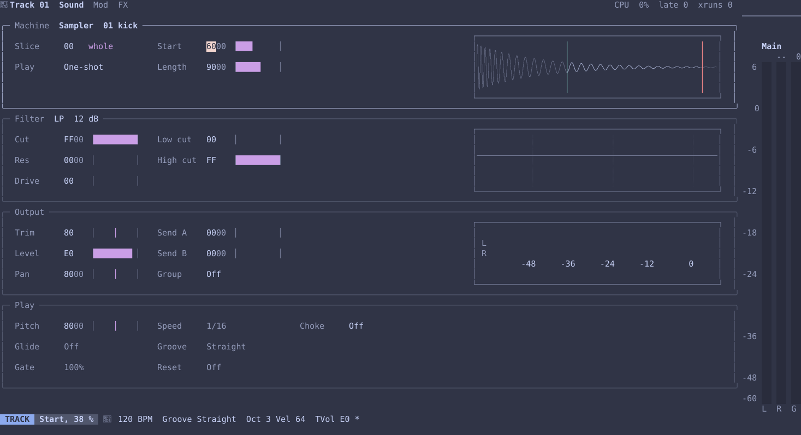
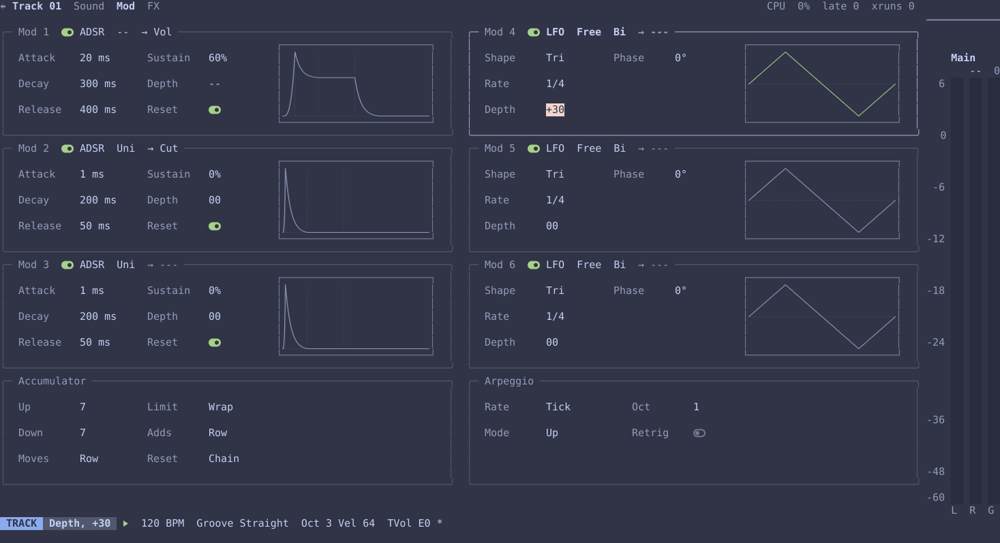
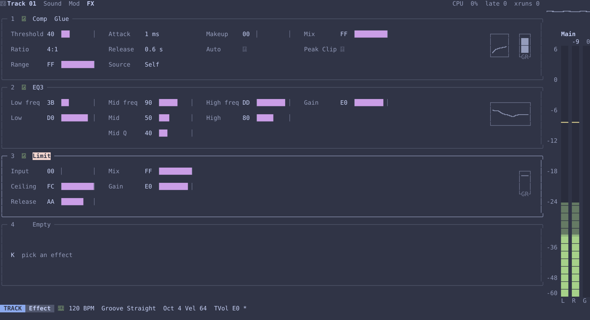
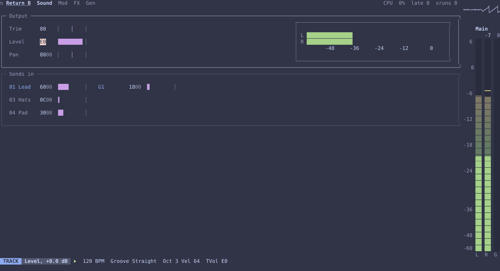
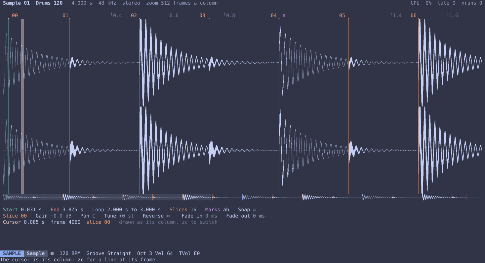

# Introduction

vimtracker is a music tracker for the terminal, written in Rust and edited with a keyboard
grammar modelled on Neovim. It takes ideas from the Polyend Tracker, the Dirtywave M8,
Elektron sequencers, Metropolix, Jeskola Buzz and Ableton Live, but it's a separate
program, and isn't affiliated with any of them.

This manual has three parts:

- **Getting started** takes you from an empty project to a loop you can hear.
- **How it works** explains the ideas the rest is built on.
- **Reference** covers each part of the program in turn.

The reference chapters are the same guides the program shows with `Space ?`, so what you
read here is what you see there. This manual is for version 0.2.0.

## Running it

It runs in [kitty](https://sw.kovidgoyal.net/kitty/) and [Ghostty](https://ghostty.org),
which have the kitty keyboard and graphics protocols, and won't start in other terminals or
inside tmux, ssh or Neovim's terminal. It uses the keyboard protocol to know when a key is
let go, so a note sounds for as long as its key is held, and the graphics protocol for its
curves, waveforms and meters. Its icons are Nerd Font symbols, which kitty and Ghostty
have built in. `vimtracker render`, `vimtracker bench` and `vimtracker probe-keys` run in
any terminal.

To run it:

```sh
cargo run --release -p vt-tui --bin vimtracker
```

or, with [just](https://github.com/casey/just) installed, `just run my-song` to open or
start a project in the folder `my-song`.

## What's in it

**Views.** `Space` and a digit go to each view: `1` the song, `2` the chain, `3` the
phrase, `4` the track pages, `5` the sample explorer, `6` the mixer, `7` the audio
device, `8` the kits, `9` the project and `0` the sample page. [Navigation](guides/navigation.md) lists them
all.

**Notes** are named as Ableton Live names them, so `C-3` is middle C, MIDI note 60, and
a note reads the same in both. A note sounds while its key is held, several held keys
play a chord, and notes can be recorded into a phrase while it plays. See [Note
entry](guides/note-entry.md).

**Editing** is Vim's: operators, counts, registers, `.` and undo. A selection stays
until `Esc` while you move or fill its values, so `+ + -` can go in one after the other
as the loop plays, with the running total on the status line. Cmd with `h` `j` `k` `l`
is `-` `_` `+` `=` wherever those work, so a value can be nudged without moving. See
[Selecting and editing](guides/editing.md).

**Tracks.** A song has up to 64 sound tracks, then four groups, `G1` to `G4`, two
returns, `A` and `B`, and the master. A sound track plays the sampler or one of the
synth voices, most of them ported from Mutable Instruments' Plaits, and `Acid`, after a
TB-303.

**The track pages**, on `Space 4`, are racks of devices, as Ableton Live's are, each a
frame with its name and what gives it its character in its title:

- **Sound** has four: the Machine with the voice's own settings, the Filter, the Output,
  and Play, with the track's pitch, glide, gate, speed, groove, reset, choke and velocity. A
  group's, a return's and the master's Sound page is the Output alone, with under it
  the tracks a group sums or what sends to a return; the master's Output ends with the
  song's limiter.
- **Mod** has three envelopes and three LFOs, each with its destination in its title,
  and the accumulator and the arpeggio. `b` switches an envelope or an LFO out, to hear
  the track without it; it keeps running underneath, so it comes back in time.
- **FX** has four slots, each a device with its effect and its type in its title, and a
  switch, `b`, to bypass it.

Every track has a **Trim** at its input, a gain for gain staging before the filter and
the slots, so `Level` is left for the mix, as a console's input trim and fader are.

**Effects** include a delay, two reverbs, chorus, phaser, flanger, tape, a three-band
EQ, a pitch shifter, a frequency shifter, granular, Warps' cross-modulation and vocoder, a low-pass gate, a
resonator, comb and formant filters, a limiter and a compressor. The compressor has three
types: `Clean`; `Console`, an SSL bus compressor fitted to Arturia's Bus FORCE; and
`Glue`, fitted to Ableton Live's Glue Compressor. `Distort` has six modes and two
guitar pedals, `Overdrive`, a Tube Screamer's circuit, and `Distortion`, an op-amp
distortion. See [The track pages: Sound, Mod and FX](guides/tracks.md).

**Graphics** are images the terminal is sent, drawn at its own pixels: the filter's
curve with a mark at its cutoff, a sampler's slice as a thumbnail with its start and end,
a meter after `Trim`, each envelope's shape and each LFO's cycle with a dot riding it
where the LFO is now, the compressor's curve and how far it's turning down, the EQ's
curve, a scope over the main meter, and the sample page's waveform.

**Icons** are Nerd Font symbols, each standing for something, as a switch's state does:
the transport on the status line, `󰐊` playing, `󰏤` paused, `󰓛` stopped and
`󰑊` recording, a red `󰀦` once audio has dropped out, and each track's machine or
kind in its heading. A dim leaf, `󰌪`, before the CPU figure at the top right means the
system is running the audio thread slowly to save power, so the figure reads higher than
the song is heavy; the audio page says by how much. See [The meter](guides/meter.md).

**Projects** are folders, saved with `:w` and opened with `:e`. `:e!` and `:new!` throw
away unsaved changes and go ahead, and `:e!` on the project's own folder goes back to
how it was last saved. `vimtracker render` writes a saved project to a WAV
file, or stems, without a sound device, and `vimtracker bench` measures how much of a
core it takes to play, by track and slot with `--tracks`, or through the sound device
with `--device`. See [Saving and rendering](guides/saving.md).

There are no presets yet: a sound is set up on its track's pages, or comes from a kit.

## The pictures

The pictures of the program in this manual are made from the program itself, with
`just screenshots`, so they show what it really draws. That includes the drawings the
terminal is sent as images, like a track's filter curve on its Sound page, above it, in
the Machine, the part of the sample it plays, and beside the Output, its meter after
`Trim`:



and on its Mod page, a device for each modulator in two columns, the envelopes with their
shapes beside the LFOs with their cycles, each with its destination in its title, and the
accumulator beside the arpeggio under them:



and on its FX page, a device for each slot, with its effect and type in its title and its
settings in three rows: a Glue compressor with its curve and a meter of how far it's turning
down, an EQ with its curve, a limiter with its meter, and an empty slot:



and a return's Sound page: the same Output a track has, with a meter of what reaches it after
its trim, and under it Sends in, every track and group sending to it with how much:



and the sample page, on `Space 0`, with the track's sample as a big waveform, left above right,
its start, end and loop marked, and an overview of the whole sample below with the part in view:



A browser has no Nerd Font of its own, so the manual comes with a copy of Symbols Nerd Font
Mono, cut down to the symbols the program uses, for the icons in its text, and the pictures
draw the same symbols' outlines.
